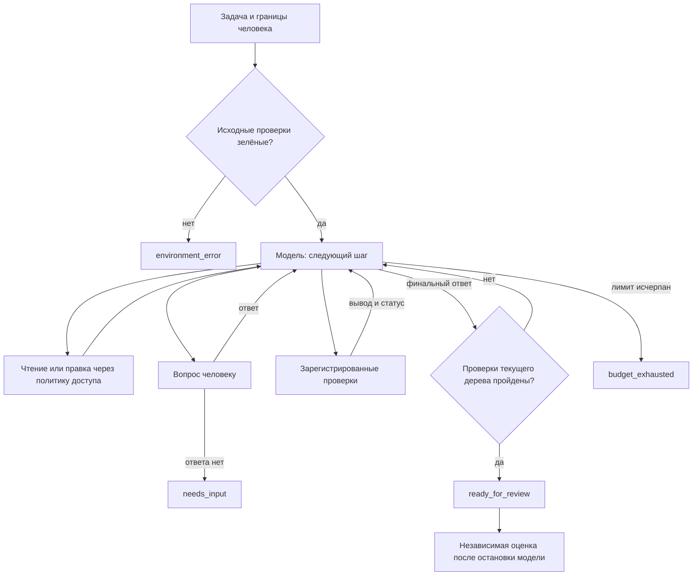

# Пилот короткого цикла

Эксперимент требований: `bench/experiments/task-loop-evidence.json`. Команда:
`node tools/compare-task-loop.ts --run --arms local,evidence --repeats 3 --cases-file bench/experiments/task-loop-evidence.json --output bench/results/task-loop-evidence`.
Режим `evidence` добавляет структурированную связь требований с зарегистрированными проверками; оба режима получают одинаковые проверки. Контракт принимает `requirements: [{id, description, source, checks}]`. Статусы `verified`, `violated`, `unverified` вычисляются только из результатов проверок текущего дерева после baseline. Пустой список проверок означает отсутствие доказательства. Самоотчёт модели не меняет статус. Проверка с `baseline:false` относится к новому поведению и запускается только после начала работы. Хотя бы одна исходная регрессионная проверка обязательна. Опциональный `maxUnchangedFailures` останавливает повтор идентичного вывода на неизменном дереве; в сравнении он отключён. Ответ человека сбрасывает этот счётчик.

Пилотные конфигурации могут задавать `fixture` с явными путями внутри `bench/fixtures` и `bench/checks`, не меняя реестр старого guided-бенча. `visibleChecks` задаются доверенной конфигурацией и исполняются вне изменяемого моделью дерева. Скрытая приёмка по-прежнему запускается только после остановки модели. Протокол новой серии: `bench/results/task-loop-evidence/protocol.md`.

`task-loop-evidence` меряет **только** разницу feedback в коротком цикле (local vs evidence). Он не является валидацией guided JSON/recovery (#2) и не заменяет guided-suite / записи в `docs/guided-flow.md`. Серия v2 (16/16, 2026-10-14): local 7/8, evidence 6/8, false success 0 — гипотезу «evidence лучше» не поддерживает; **evidence не включать в продукт по умолчанию**. Неотвеченный AskHuman при уже зелёных registered checks больше не роняет виток в `needs_input` и **не зовёт банк** (`ignored_after_green` — иначе `fallback` портил `obligations.questions` / falseSuccess). AskHuman про запись вне `writable`, harness, технику реализации, **переподтверждение поведения из task** или **мета-ревью** (satisfy requirements / scope / limitations) отвечает рантайм (`source: runtime`) и не даёт `needs_input`. Имя видимой проверки — `public-api` (не путь на диске). При `requireNewTest` finish требует новый файл под `test/` **той же формы, что seed-сюит** (расширение и `.test.`/`.spec.`, если так устроен fixture) — голый `.js` при suite на `.mjs` ready не открывает. На `ProviderEnvError` — до двух дополнительных повторов чата. Серия 5×5 (2026-10-14): qwen 5/5, gpt-oss 4/5; см. `bench/results/task-loop-recent5x5-20261015004712/conclusions.ru.md`. Следующий замер — ≥3 повтора в новом каталоге после смены `sourceHash`.

Пилот запускает один `LoopExecutor`: задача и границы человека → чтение → правка → реальные проверки → ремонт → итог. Обязательных документов Intent/Explore/Plan перед правкой нет. Основной SDLC-флоу и его UI не переключены на пилот.



Границы записи задаёт человек точными путями и префиксами каталогов. Модель не может расширять их через свой план. Сохраняются общие policy-проверки, защита файлов, проверка символических ссылок и запрет разрушающих перезаписей. Модель получает Read, Glob, Grep, Write, Edit, AskHuman и зарегистрированный check; произвольной оболочки нет. Команды проверки фиксирует адаптер до старта. Текущий стенд поддерживает только Node-команды из доверенного package.json; универсальная поддержка языков не заявлена. Выполнение кода проверками не является изоляцией на уровне ОС.

Сначала выполняются baseline-проверки. В этом пилоте красный baseline — `environment_error`; ремонт исходно сломанного проекта требует отдельного дизайна. Для `ready_for_review` нужны финальный ответ модели и успешные проверки текущего полного дерева, включая новые файлы. Любая правка инвалидирует доказательства. Проверка, меняющая дерево, также не даёт свежего доказательства. `ready_for_review` не означает, что все требования доказаны.

Другие исходы: `needs_input`, `failed`, `budget_exhausted`, `environment_error`. Вопросы доступны в любой момент. Банк отвечает только на совпавшие содержательные правила; неизвестный/лишний вопрос останавливает прогон, а источник ответа остаётся в логе. Ожидание человека исключается из активного времени. Отмена действует и во время ожидания. Активный лимит отменяет запрос модели и проверки; лимит ходов отдельный.

Запуск:

```powershell
node tools/task-loop-pilot.ts
node tools/task-loop-pilot.ts --run --task add-validator --model ollama:qwen3.8-27b-iq4-gpumax --output bench/results/my-pilot
node tools/render-task-loop.mjs bench/results/my-pilot
```

Результаты: `passport.json` (маршрут, исходники, условия), `status.json` (пульс), `events.ndjson` (запросы/ответы и результаты инструментов), `result.json`, `tracked.patch`, `patch-files/`. Рабочая копия сохраняется отдельно для аудита. HTML содержит полные тексты и фильтр событий; это отдельный просмотрщик пилота. Логи находятся вне доступной модели копии.

Метрики: число запросов, фактические изменения файлов, отказы политики, ремонт после упавшей проверки, повторные ошибки, время до первой правки/проверки, ожидание человека, активное время, usage и валюта. Запись учитывается даже при последующей ошибке диагностики инструмента; его исходный статус сохраняется. Неизвестная цена остаётся `null`; для ручного контроля недоступны также реальные токены. При обрыве запроса без usage стоимость неизвестна, а накопленные токены отражают только завершённую часть работы; событие `model_request_failed` отмечает этот пробел. Сбой телеметрии считается отдельно. Ценовой лимит API проверяется между запросами, поэтому последний запрос может его превысить; строгий денежный потолок должен быть установлен у провайдера. Неизвестная цена останавливает последующие платные запросы.

`firstCheckMs` — начало первой проверки, запрошенной моделью, без исходного baseline; `firstEditMs` — момент первой учтённой правки. Оба отсчитываются от старта по стенным часам. `activeMs` отдельно исключает ожидание человека. `repairs` считает попытки правки после проваленной проверки, а не гарантированно успешные исправления. `repeatedErrors` считает повторы одинакового краткого сообщения инструмента; смысловую идентичность разных ошибок эта метрика не устанавливает.

Матрица фиксируется в `bench/experiments/task-loop-cases.json`: четыре задачи, два повтора, baseline guided v4 / короткий локальный / контроль. Во всех плечах активный лимит 10 минут. Baseline сохраняет свои поэтапные лимиты, локальный цикл получает 40 запросов на задачу. Общая независимая оценка проверяет поведение скрытыми тестами, границы файлов, необходимые вопросы, дополнительные исполнившиеся тесты и обязательную правку документации. Для тестового обязательства сравнивается число успешных тестов доверенной Node-команды на исходном и итоговом дереве: новый файл сам по себе не является доказательством, новые случаи в разрешённом существующем файле допустимы. Смысл тестовых утверждений, документации и непокрытые требования остаются предметом ревью. Исходные фикстуры и скрытые тесты не меняются.

В первой серии оценщик v1 ошибочно требовал новый тестовый файл. Оценщик v2 исправляет это общее предположение, не меняя модельный цикл. Завершённые решения пересчитаны по сохранённым деревьям; исходные оценки лежат в `*.grading-v1.json`, переход — в `evaluation-transition.json`, а исходные паспорта выполнения сохраняют прежние хеши. Дополнительные ручные проверки сохраняются отдельно как `manual-audit.json` и не выдаются за часть первоначального скрытого набора.

В первых четырёх локальных запусках адаптер ошибочно задавал `temperature: 0`, тогда как baseline наследовал температуру модели Ollama `0.15`. Эти результаты исключены из основного сравнения и сохранены в `temperature-zero-diagnostic.json` с исходными каталогами. Все локальные ячейки повторены с `temperature: null`, как в существующем маршруте; серверное значение зафиксировано в `environment.json`. Переход и основания сохранения baseline и ручного контроля записаны в `sampling-transition.json`. Это исправление условий эксперимента, а не улучшение оценки уже полученных решений.

```powershell
node tools/compare-task-loop.ts
node tools/compare-task-loop.ts --run --arms local,baseline --output bench/results/task-loop-comparison
node tools/render-task-loop-comparison.mjs bench/results/task-loop-comparison
```

Сводный просмотрщик создаёт `index.html` со ссылками на ленты, `summary.ru.md` и `summary.json`. Он показывает автоматическую оценку отдельно от дополнительных проверок из `manual-audit.json`. В summary v3 отдельно считаются `hiddenTimeoutRejects` и `readyWithUnverifiedRequirements` (advisory full-contract с пустым `checks` не блокирует ready). Завершённая первая серия и её ограничения сохраняются в `bench/results/task-loop-comparison/`.

После первой серии исправлены счётчики записей с последующей ошибкой диагностики, неизвестная стоимость оборванного запроса и завершение `active.json`; в события запросов явно добавлена температура. Измеренная версия исходников лежит в `runtime-before-telemetry/`, изменения — в `post-series-changes.json`, финальные проверки — в `final-validation.json`. Сами результаты 24 запусков не переписаны под новую телеметрию.

Повторный запуск пропускает завершённые ячейки; изменение исходников требует новой серии. Файл `STOP_AFTER_CURRENT` в каталоге серии останавливает очередь после текущего прогона. Прерванный прогон без результата автоматически не перезапускается, чтобы не породить конкурирующие процессы.

По просьбе пользователя вместо недоступного API используется текущая сессия ассистента. `--model assistant-session --bridge <dir>` передаёт ей ровно сообщения и инструменты того же LoopExecutor. Запрос появляется как `NNN.request.json`, ответ — `NNN.response.json` с `{text, calls:[{name,arguments}]}`. Новую директорию нужно использовать для каждого прогона. Этот контроль НЕ слепой: ассистент видел проект и разбор задач; в повторах после чтения исходников повторно применялись подготовленные решения. Это повтор исполнения, а не независимая генерация для статистики качества. Он проверяет работоспособность интерфейса, но не доказывает превосходство модели. Для независимого сравнения нужен отдельный API-маршрут и заранее установленный бюджет.

Критерий следующего шага: локальная модель закрывает хотя бы одну задачу в обоих повторах без нарушения границ или выявленного ложного успеха; затем отдельный holdout. Дообучение и включение по умолчанию отложены. Нужны проверенные траектории и отложенные задачи, а не обучение на зелёных самоотчётах.

Следующая серия проверяет перенос короткого цикла на четыре другие существующие задачи: `bench/experiments/task-loop-transfer.json`, два повтора, только локальный маршрут. Эти фикстуры могли участвовать в старых guided-экспериментах; серия не объявляется новым слепым holdout. Историческая серия не является сопоставимым контролем. Конфигурации выбираются через `--cases-file` из `bench/experiments/`; дополнительные независимые проверки регистрируются полем `acceptanceFile` из `bench/checks/`. Оба каталога входят в отпечаток исходников.

```powershell
node tools/compare-task-loop.ts --run --arms local --cases-file bench/experiments/task-loop-transfer.json --output bench/results/task-loop-transfer
node tools/render-task-loop-comparison.mjs bench/results/task-loop-transfer
```

Оценка v3 включает дополнительные проверки в автоматическую приёмку и проверяет неизменность дерева при оценивании. Проверки и критерии фиксируются до первого ответа модели, запускаются после её остановки и не передаются ей для исправления. Самопроверка оценщика с правильными и намеренно сломанными реализациями сохраняется как `preflight.json`; это не модельные прогоны. Первый пилот и его оценки не переписываются.

В серии переноса 8/8 запусков прошли исходную оценку, но ревью нашло три нарушения. Они закреплены отдельной конфигурацией `task-loop-transfer-revised.json` и проверками `bench/checks/acceptance-v2/`: экспорт функции из требуемого модуля и сохранение исходных значений сообщения при идемпотентности. Пересчёт сохранённых кандидатов дал 5/8. Генерация не повторялась; новые проверки построены после наблюдения ошибок, поэтому это ретроспективная регрессия, а не новый слепой holdout. Исходные результаты и проверки сохранены; `retrospective.json` и `assessment-revised.json` содержат отдельные оценки.
